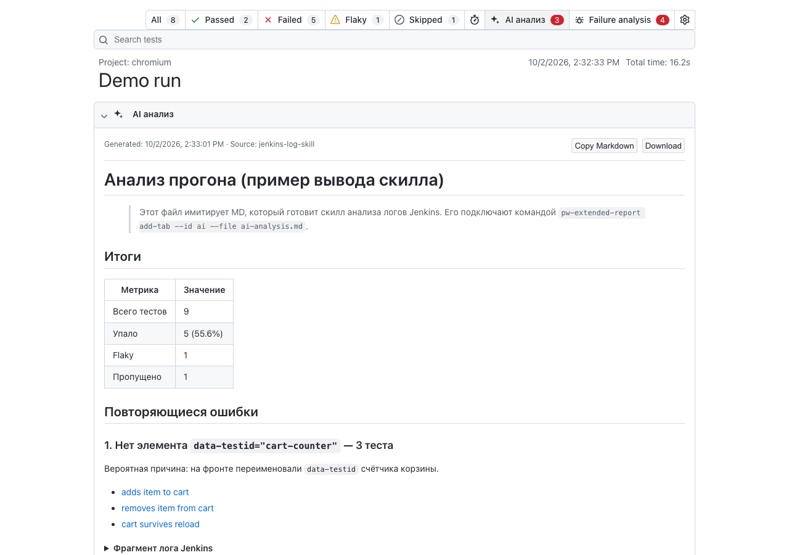
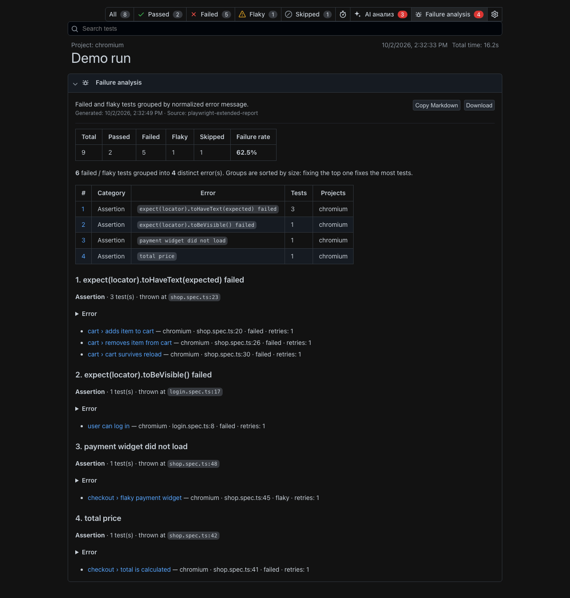

# playwright-extended-report

Клон штатного HTML-отчёта Playwright с возможностью добавлять **свои вкладки**:
анализ логов Jenkins, AI-разбор падений, любые Markdown/HTML-страницы и встроенную
вкладку **Failure analysis** (группировка упавших тестов по ошибке).

Это **отдельный репортёр**: штатный `html`-отчёт продолжает генерироваться как раньше,
а расширенный пишется в свою папку (`extended-report/` по умолчанию). Внешний вид, навигация,
фильтры, trace viewer, «Copy prompt» те же, что у штатного отчёта, потому что UI скопирован
из исходников Playwright.



<details>
<summary>Ещё скриншоты (тёмная тема, Failure analysis, обзор)</summary>




</details>

## Что умеет

- **Свои вкладки** в верхней панели рядом с `All / Passed / Failed / Flaky / Skipped`: иконка, счётчик (badge),
  порядок, описание, источник. Форматы: `markdown` (GFM: таблицы, чек-листы, `<details>`), `html` (санитизируется),
  `iframe` (любая страница со своим JS, например дашборд).
- **Добавление вкладок после прогона** через CLI: `pw-extended-report add-tab`. Это сценарий для Jenkins:
  тесты прошли, скилл подготовил MD, вы прицепили его к отчёту. Повторный вызов с тем же `--id` заменяет вкладку.
- **Ссылки из Markdown в отчёт**:
  - `[тест](#?test=Название теста)` открывает тест по названию (скилл знает названия из логов, а `testId` не знает);
  - `[упавшие](#?q=s:failed)` ведёт на любой фильтр штатного поиска;
  - `[вкладка](#?tab=failures)` открывает другую вкладку, `[раздел](#заголовок)` скроллит к заголовку.
- **Встроенная вкладка Failure analysis**: упавшие и flaky тесты сгруппированы по нормализованной сигнатуре ошибки
  (тип, локатор, ожидание), с категорией (Assertion / Locator / Timeout / Network / Browser crash / Snapshot),
  процентом падений и местом в коде, где ошибка возникает чаще всего.
- **`report-summary.json`** — машиночитаемая сводка (статистика, упавшие тесты с ошибками и путями к вложениям,
  кластеры). Это готовый вход для LLM или вашего скилла, без парсинга HTML и логов Jenkins.
- **Совместимость**: использует только публичный Reporter API, проверено на Playwright **1.45, 1.52, 1.63**.
  Trace viewer берётся из `playwright-core` вашего проекта, поэтому версия всегда совпадает с трейсами.
- Работает с шардингом: `merge-reports` подходит и для нашего репортёра.

## Быстрый старт

### 1. Сборка и упаковка пакета

```bash
git clone <this-repo> && cd playwright-extended-report
npm ci
npm run build          # web UI (vite) -> dist/web, репортёр и CLI (tsc) -> dist/
npm test               # e2e: прогон example/, генерация отчёта, проверки в браузере
npm pack               # -> playwright-extended-report-<version>.tgz
```

Публикация во внутренний Nexus описана в [docs/PUBLISHING.md](docs/PUBLISHING.md). Перед публикацией
стоит дать пакету свой scope, например `@qa/playwright-extended-report`.

### 2. Подключение в проект с автотестами

```bash
npm i -D playwright-extended-report      # или @your-scope/playwright-extended-report из Nexus
```

```ts
// playwright.config.ts
export default defineConfig({
  reporter: [
    ['html'],                                   // штатный отчёт без изменений
    ['playwright-extended-report', {
      outputFolder: 'extended-report',          // своя папка
      title: 'Regression',
      // необязательно: вкладки, которые уже есть на момент генерации
      tabs: [{ id: 'notes', title: 'Notes', file: './run-notes.md', optional: true }],
    }],
  ],
});
```

### 3. После прогона: добавить вкладку со своим анализом

```bash
npx playwright test || true

# ваш скилл анализа логов Jenkins пишет analysis.md, затем:
npx pw-extended-report add-tab extended-report \
  --id ai --title "AI анализ" --icon sparkle \
  --file analysis.md --badge 3 --badge-kind danger --source jenkins-log-skill --order 10

npx pw-extended-report show extended-report      # локальный просмотр
```

Пример `Jenkinsfile` и настройка CSP для HTML Publisher: [docs/JENKINS.md](docs/JENKINS.md).

## CLI

```
pw-extended-report add-tab   [report-dir] --id <id> (--file <path>|--content <text>) [options]
pw-extended-report remove-tab [report-dir] --id <id>
pw-extended-report list-tabs  [report-dir]
pw-extended-report show       [report-dir] [--host] [--port] [--no-open]
```

| Опция `add-tab` | Описание |
|---|---|
| `--id` | id вкладки, попадает в URL: `#?tab=<id>`. Буквы, цифры, `-`, `_`. |
| `--title` | Подпись в панели. |
| `--file` | `.md`, `.html` или папка с `index.html` (iframe). `-` означает stdin. |
| `--content` | Содержимое строкой вместо файла. |
| `--format` | `markdown` \| `html` \| `iframe`. По умолчанию определяется по расширению. |
| `--icon` | `sparkle` \| `bug` \| `graph` \| `note` \| `list` \| `none`. |
| `--badge`, `--badge-kind` | Счётчик и его цвет: `default` \| `danger` \| `attention` \| `success`. |
| `--order` | Сортировка: меньше значит левее. Встроенная Failure analysis имеет `100`. |
| `--description`, `--source` | Подзаголовок и источник, показываются над содержимым. |
| `--optional` | Если файла нет, тихо пропустить (exit 0). Удобно в пайплайне. |

`report-dir` по умолчанию `./extended-report`. Та же функциональность доступна программно:

```ts
import { upsertTab, readTabs, removeTab } from 'playwright-extended-report';
await upsertTab('extended-report', { id: 'ai', title: 'AI', file: 'analysis.md', icon: 'sparkle' });
```

## Опции репортёра

| Опция | По умолчанию | Env | |
|---|---|---|---|
| `outputFolder` | `extended-report` | `EXTENDED_REPORT_OUTPUT_DIR` | Папка отчёта, очищается перед генерацией. |
| `title` | — | `EXTENDED_REPORT_TITLE` | Заголовок отчёта. |
| `open` | `never` | `EXTENDED_REPORT_OPEN` | `always` \| `never` \| `on-failure`. |
| `host`, `port` | — | `EXTENDED_REPORT_HOST/PORT` | Для `open`. |
| `tabs` | `[]` | — | Вкладки на момент генерации: `{ id, title, file \| content, format?, icon?, badge?, order?, optional? }`. |
| `failureClusters` | `true` | — | `false` или `{ title?, order? }`. |
| `summaryJson` | `true` | — | Писать `report-summary.json`. |
| `noSnippets`, `noCopyPrompt`, `doNotInlineAssets`, `mergeFiles`, `attachmentsBaseURL` | как у `html` | `EXTENDED_REPORT_*` | Те же опции, что у штатного репортёра. |

Переменные окружения намеренно не `PLAYWRIGHT_HTML_*`: иначе оба отчёта писали бы в одну папку.

## Документация

- [docs/ARCHITECTURE.md](docs/ARCHITECTURE.md) — как устроен штатный отчёт Playwright и что изменено здесь.
- [docs/CUSTOM_TABS.md](docs/CUSTOM_TABS.md) — формат вкладок, ссылки, как добавить свой тип вкладки в UI.
- [docs/JENKINS.md](docs/JENKINS.md) — пайплайн, публикация отчёта, CSP.
- [docs/LLM_INTEGRATION.md](docs/LLM_INTEGRATION.md) — как подключить LLM / скилл: входные данные, промпт, вывод во вкладку.
- [docs/UPSTREAM_SYNC.md](docs/UPSTREAM_SYNC.md) — как подтягивать новые версии UI из Playwright.
- [docs/PUBLISHING.md](docs/PUBLISHING.md) — сборка, версионирование, публикация в Nexus.
- [docs/IDEAS.md](docs/IDEAS.md) — исследование существующих решений и идеи развития отчёта.

## Структура репозитория

```
web/                 UI отчёта (React + Vite)
  src/               копия packages/html-reporter/src из Playwright + патчи с маркером [extended-report]
  src/extended/      наш код: вкладки, Markdown, иконки, стили
  vendor/            нужные файлы из packages/web и packages/isomorphic (без изменений)
src/
  reporter/html.ts   порт packages/playwright/src/reporters/html.ts на публичный API
  reporter/compat.ts замены внутренних утилит Playwright
  reporter/failureClusters.ts  группировка падений
  tabs.ts            чтение и запись вкладок в index.html
  cli/index.ts       CLI pw-extended-report
  server.ts          локальный просмотр
  shared/tabsFormat.ts  формат вкладок (общий для Node и UI)
upstream/            эталонная копия html.ts и версия Playwright, с которой синхронизировано
example/             демо-проект с намеренно падающими тестами
tests/               e2e-проверки пакета
scripts/sync-upstream.mjs    синхронизация с исходниками Playwright
```

## Лицензия

Apache-2.0. Код UI и репортёра основан на [Playwright](https://github.com/microsoft/playwright)
(© Microsoft Corporation), подробности в [NOTICE](NOTICE).
