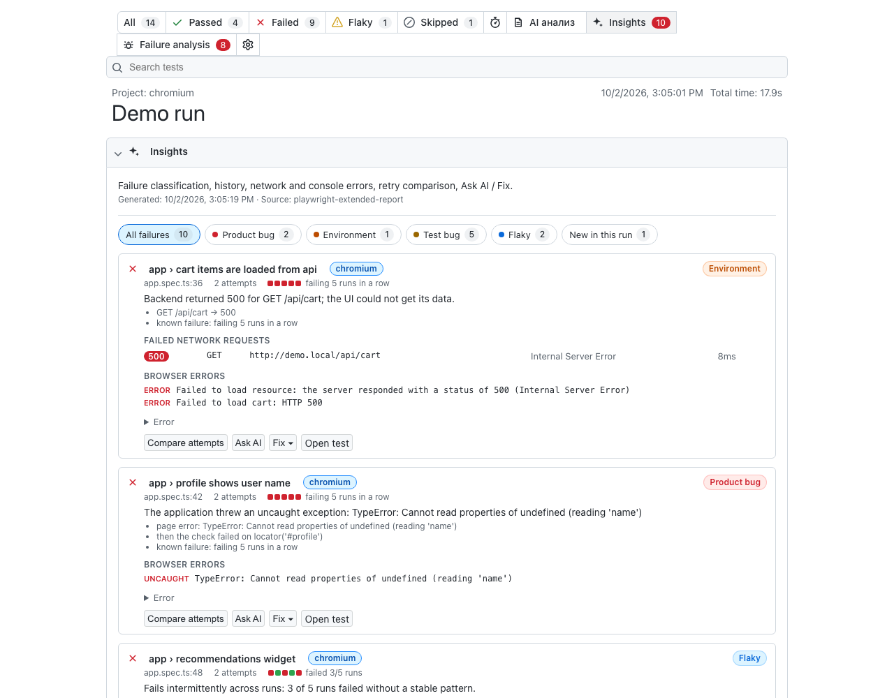
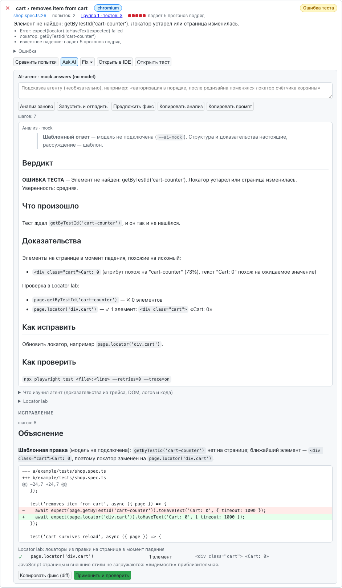
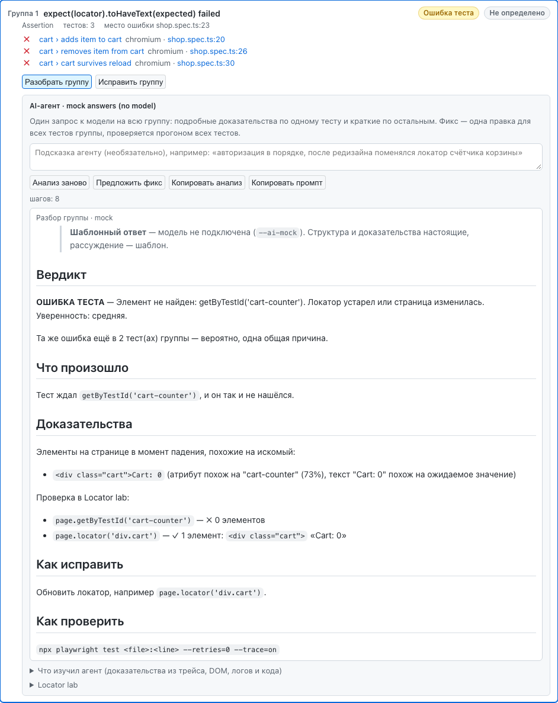
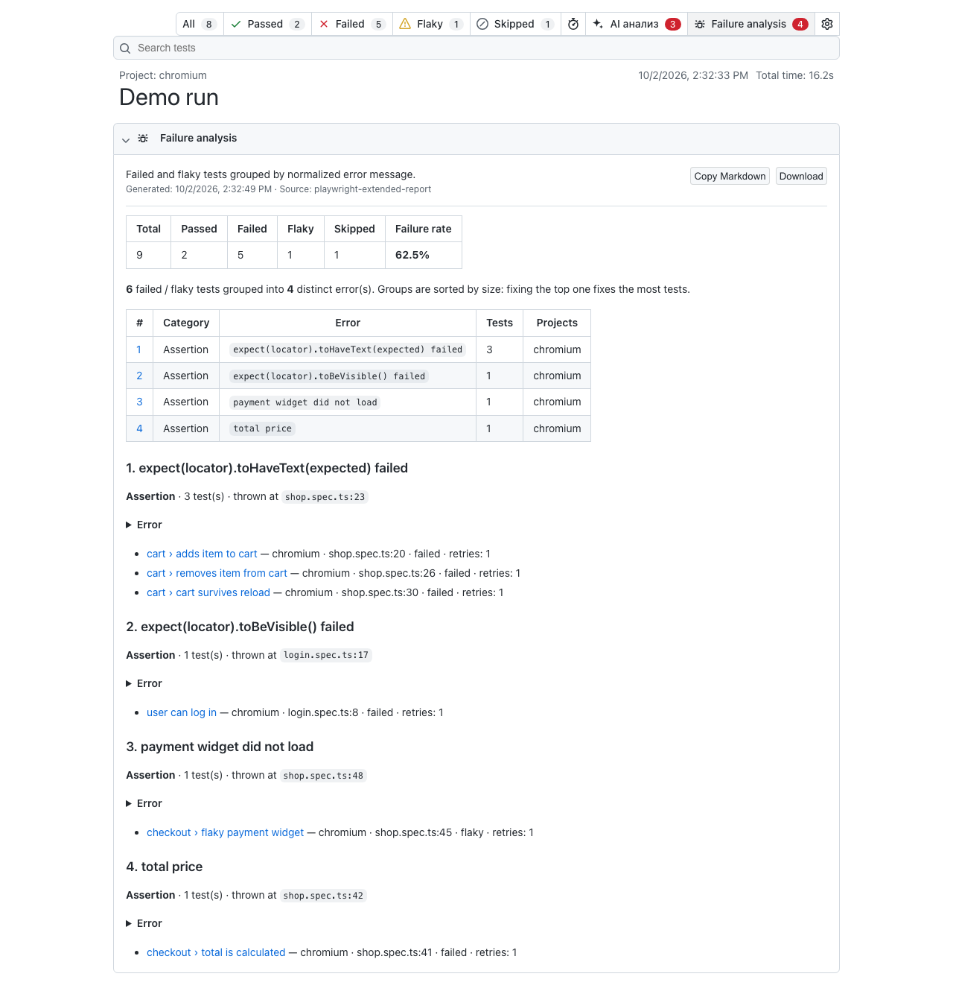
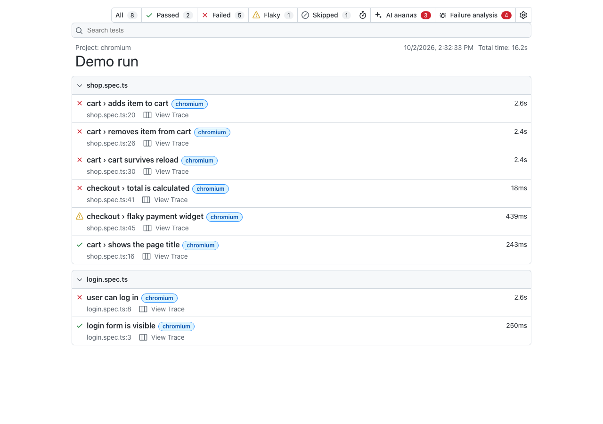

# playwright-extended-report

Клон штатного HTML-отчёта Playwright с дополнительными вкладками и **AI-агентом для упавших тестов**,
который работает с моделями закрытого контура (GigaChat, Proxy LLM, GigaCode) и вашими MCP-серверами
(serena, code-index, codebase-memory, context7, playwright).

- **Failure analysis** — анализ вашего скилла (логи Jenkins), AI-разбор групп ошибок из CI и встроенная группировка — в одной вкладке.
- **Insights** — классификация каждого падения, сеть и консоль из трейса (с cURL и баг-репортом), сравнение попыток, группы ошибок.
- **Ask AI / Fix / Открыть в IDE** — глубокий анализ по трейсу и DOM, Locator lab, перезапуск и отладка, правка с диффом,
  применение с проверкой и откат по кнопке; для одного теста или сразу для группы.
- Свои вкладки с любым Markdown, HTML или страницей.
- Всё, что генерируется (анализ, промпты, классификация), — **на русском** (английский — настройкой).



<details>
<summary>Ещё скриншоты: агент, группа ошибок, Failure analysis</summary>






</details>

## Попробовать за минуту

```bash
npm ci && npm run build && npx playwright install chromium
npm run demo        # 5 прогонов демо-проекта, анализ «скилла», отчёт с агентом на http://localhost:9324
```

В демо модель не подключена: ответы агента — шаблоны с пометкой «Шаблонный ответ», а доказательства из трейса,
Locator lab, перезапуск, дифф и проверка правки — настоящие. С вашей моделью: переменные из
[docs/AGENT.md](docs/AGENT.md) и `npm run demo -- --ai`.

## Как это устроено (коротко)

```
autotests ──► playwright test ──► playwright-report/   (штатный, без изменений)
                              └─► extended-report/     (этот пакет: + Failure analysis, Insights, кнопки агента)

AI-агент = команды того же пакета:
  локально:  npx pw-extended-report agent ./extended-report      → анализ, перезапуск, фиксы, Open in IDE
  Jenkins:   Docker-контейнер `ai-gateway` на виртуалке           → кнопки в отчётах из Jenkins (анализ)
             npx pw-extended-report analyze extended-report       → AI-разбор групп заранее, прямо в отчёт
```

Подробно, по шагам, с пайплайном и Docker: **[docs/DEPLOYMENT.md](docs/DEPLOYMENT.md)**.

## Быстрый старт

### 1. Сборка и упаковка пакета

```bash
git clone <this-repo> && cd playwright-extended-report
npm ci
npm run build          # web UI (vite) -> dist/web, репортёр, агент и CLI (tsc) -> dist/
npm test               # e2e: демо-проект, отчёт, агент, MCP, Locator lab — в браузере
npm pack               # -> playwright-extended-report-<version>.tgz
```

Публикация во внутренний Nexus: [docs/PUBLISHING.md](docs/PUBLISHING.md).

### 2. Подключение в проект с автотестами

```bash
npm i -D @qa/playwright-extended-report      # имя из вашего Nexus
```

```ts
// playwright.config.ts
export default defineConfig({
  use: { trace: 'retain-on-failure' },        // трейс нужен для глубокого анализа
  reporter: [
    ['html'],                                   // штатный отчёт без изменений
    ['@qa/playwright-extended-report', {
      outputFolder: 'extended-report',
      title: 'Regression',
    }],
  ],
});
```

### 3. После прогона в Jenkins

```bash
npx playwright test || true
npx pw-extended-report add-analysis extended-report --file analysis.md --source "jenkins-log-skill #123"   # ваш скилл
npx pw-extended-report analyze extended-report --agent-url http://jenkins-vm:8787/ --max 10                 # AI-разбор групп
```

Полный `Jenkinsfile`, Docker-бэкенд агента, CSP: [docs/DEPLOYMENT.md](docs/DEPLOYMENT.md), [docs/JENKINS.md](docs/JENKINS.md).

### 4. Локально: разобрать, отладить, починить

```bash
cd my-autotests
export EXTENDED_REPORT_AI_PROVIDER=gigachat GIGACHAT_AUTHORIZATION_KEY=... GIGACHAT_SCOPE=GIGACHAT_API_CORP
npx pw-extended-report agent ./extended-report    # Ask AI, Запустить и отладить, Предложить фикс, Применить и проверить
```

Провайдеры (Proxy LLM, GigaChat, GigaCode IFT SSL, GigaCode CLI), MCP-серверы, Open in IDE: [docs/AGENT.md](docs/AGENT.md).

## Что умеет

- **Вкладка Failure analysis**: вводное описание → **анализ вашего скилла** (`add-analysis`) → **AI-разбор групп ошибок,
  подготовленный в CI** (`analyze`) → **встроенная группировка** упавших тестов по нормализованной ошибке
  (категория, доля падений, место в коде, ссылка «Разобрать группу с AI-агентом →»).
- **Вкладка Insights** ([docs/INSIGHTS.md](docs/INSIGHTS.md)):
  1. классификация каждого падения: *баг продукта / ошибка теста / окружение / изменение UI / нестабильный*, с объяснением и фактами;
  2. упавшие запросы (4xx/5xx) с телом ответа, **cURL** и **баг-репортом для бэкенда**; ошибки консоли и исключения — из `trace.zip`;
  3. **сравнение попыток** (ретраев) внутри прогона: где разошлись шаги, что стало медленнее, скриншоты;
  4. вид **«По группам ошибок»**: разбор и фикс сразу для всей группы;
  5. история между прогонами (опционально): новые / известные падения, нестабильные тесты, регрессии длительности.
- **AI-агент** ([docs/AGENT.md](docs/AGENT.md)): сначала MCP-путь (модель вызывает ваши MCP-инструменты и встроенные
  Locator lab / чтение исходников), при сбое — простой путь без инструментов. Глубокий анализ по трейсу и DOM, Locator lab,
  перезапуск и отладка, правка с диффом, применение с проверкой и откат, «подсказка агенту», разбор и фикс группы,
  копирование анализа, промпта и диффа. Кнопки — в карточках Insights и на странице каждого упавшего теста.
- **Открыть в IDE**: VS Code, Cursor, IntelliJ IDEA, WebStorm, PyCharm (URL-схема) или любая IDE, включая GigaIDE,
  через локального агента. Каждый выбирает свою в ⚙ отчёта.
- **Свои вкладки и секции**: `add-tab`, `add-section`; Markdown, HTML, iframe; ссылки `[тест](#?test=Название)`.
- **`report-summary.json`** — машиночитаемая сводка (упавшие тесты, ошибки, группы, классификация) для скилла / LLM.
- **Совместимость**: только публичный Reporter API, проверено на Playwright 1.45, 1.52, 1.63; шардинг и `merge-reports`.

## CLI

```
pw-extended-report add-analysis   [report-dir] --file <path> [--title] [--source] [--optional]
pw-extended-report add-section    [report-dir] --tab <tab-id> --id <id> (--file|--content) [--title]
pw-extended-report remove-section [report-dir] --tab <tab-id> --id <id>
pw-extended-report add-tab        [report-dir] --id <id> (--file <path>|--content <text>) [options]
pw-extended-report remove-tab     [report-dir] --id <id>
pw-extended-report list-tabs      [report-dir]
pw-extended-report show           [report-dir] [--host] [--port] [--no-open] [--ai | --ai-mock] [--repo <dir>] [--config <file>]
pw-extended-report agent          [report-dir] [--repo <dir>] [--config <file>] [--ai-mock]
pw-extended-report ai-gateway     [--host] [--port] [--ai-mock] [--repo <dir>] [--allow-run]
pw-extended-report analyze        [report-dir] [--max <n>] [--scope groups|tests] [--agent-url <url>] [--repo <dir>] [--strict]

агент (show --ai / agent / ai-gateway / analyze): --mcp-config <file>, --no-mcp
```

`report-dir` по умолчанию `./extended-report`. Подробно: `pw-extended-report help`.

| Опция `add-tab` | Описание |
|---|---|
| `--id` | id вкладки, попадает в URL: `#?tab=<id>`. Буквы, цифры, `-`, `_`. |
| `--title` | Подпись в панели. |
| `--file` | `.md`, `.html` или папка с `index.html` (iframe). `-` означает stdin. |
| `--content` | Содержимое строкой вместо файла. |
| `--format` | `markdown` \| `html` \| `iframe`. По умолчанию по расширению. |
| `--icon` | `sparkle` \| `bug` \| `graph` \| `note` \| `list` \| `none`. |
| `--badge`, `--badge-kind` | Счётчик и его цвет: `default` \| `danger` \| `attention` \| `success`. |
| `--order` | Сортировка: меньше — левее. Insights — `50`, Failure analysis — `100`. |
| `--description`, `--source` | Подзаголовок и источник. |
| `--optional` | Если файла нет — тихо пропустить (exit 0). |

## Опции репортёра

| Опция | По умолчанию | Env | |
|---|---|---|---|
| `outputFolder` | `extended-report` | `EXTENDED_REPORT_OUTPUT_DIR` | Папка отчёта, очищается перед генерацией. |
| `title` | — | `EXTENDED_REPORT_TITLE` | Заголовок отчёта. |
| `language` | `ru` | `EXTENDED_REPORT_LANGUAGE` | Язык генерируемых текстов: `ru` \| `en`. |
| `open` | `never` | `EXTENDED_REPORT_OPEN` | `always` \| `never` \| `on-failure`. |
| `host`, `port` | — | `EXTENDED_REPORT_HOST/PORT` | Для `open`. |
| `tabs` | `[]` | — | Вкладки на момент генерации: `{ id, title, file \| content, format?, icon?, badge?, order?, optional? }`. |
| `failureClusters` | `true` | — | `false` или `{ title?, order?, description?, sections? }`. |
| `summaryJson` | `true` | — | Писать `report-summary.json`. |
| `insights` | `true` | `EXTENDED_REPORT_AI_ENDPOINT`, `EXTENDED_REPORT_FIX_URL`, `EXTENDED_REPORT_HISTORY_FILE`, `EXTENDED_REPORT_RUN_ID`, `EXTENDED_REPORT_UNMASK_SECRETS` | `false` или `{ title?, order?, history?: false \| { file?, maxRuns? }, traces?, aiEndpoint?, fixUrlTemplate? }`, см. INSIGHTS.md. История выключена по умолчанию. |
| `noSnippets`, `noCopyPrompt`, `doNotInlineAssets`, `mergeFiles`, `attachmentsBaseURL` | как у `html` | `EXTENDED_REPORT_*` | Те же опции, что у штатного репортёра. |

Переменные окружения намеренно не `PLAYWRIGHT_HTML_*`: иначе оба отчёта писали бы в одну папку.

## Что учесть

- **Jenkins и CSP.** HTML Publisher по умолчанию блокирует скрипты отчёта; если штатный отчёт Playwright у вас уже
  открывается в Jenkins, этот тоже заработает. Для кнопок агента добавьте `connect-src` на адрес Docker-агента.
  См. [docs/JENKINS.md](docs/JENKINS.md), [docs/DEPLOYMENT.md](docs/DEPLOYMENT.md).
- **Трейсы.** Глубокий анализ, Locator lab, сеть и консоль строятся из `trace.zip`: включите `trace: 'retain-on-failure'`
  (или `on-first-retry`). Без трейса агент работает только по тексту ошибки.
- **`file://`.** При открытии `index.html` как файла не работают trace viewer, «Copy prompt» и живой агент — браузер
  запрещает `fetch`. Разбор из CI (`analyze`) виден и так. Смотрите через `pw-extended-report show/agent` или Jenkins.
- **Агент меняет файлы** только в режиме `pw-extended-report agent` (локально) и только по кнопке «Применить и проверить»,
  с бэкапом и откатом. Добавьте `.pw-extended-report/` в `.gitignore`. Docker-агент на общей виртуалке — только анализ.
- **История между прогонами выключена по умолчанию** (`insights: { history: {} }` — включить). Сравнение попыток
  работает внутри текущего прогона и без неё.
- **Шарды.** В объединённом (`merge-reports`) отчёте пустой таймлайн шардов в Speedboard (данные доступны только
  внутреннему API Playwright). Остальное работает.
- **Nexus.** `package-lock.json` указывает на registry.npmjs.org — пересоздайте его через ваш registry и задайте пакету
  scope, например `@qa/…` ([docs/PUBLISHING.md](docs/PUBLISHING.md)).
- **UI встраивается в отчёт при генерации.** После обновления пакета исправления интерфейса появляются только
  в новых отчётах; уже сгенерированные отчёты показывают ту версию UI, с которой были созданы.
- **Копирование** (анализ, промпт, фикс, cURL) работает и там, где браузер запрещает Clipboard API (webview VS Code / IDE,
  отчёт из Jenkins по `http://`); если запрещено всё — текст показывается выделенным для Ctrl+C / ⌘C.
- **Качество анализа** зависит от модели и `EXTENDED_REPORT_AI_MAX_CHARS`; классификация в Insights — эвристика,
  уточняет её агент. В демо (`--ai-mock`) ответы — шаблоны.

## Документация

- [docs/DEPLOYMENT.md](docs/DEPLOYMENT.md) — **как всё устроено, развернуть локально и в Jenkins (Docker), пайплайн, диагностика**.
- [docs/AGENT.md](docs/AGENT.md) — AI-агент: модели (GigaChat / GigaCode / Proxy LLM), MCP, Locator lab, группы, Open in IDE, безопасность.
- [docs/INSIGHTS.md](docs/INSIGHTS.md) — вкладка Insights: классификация, сеть и консоль, cURL, сравнение попыток, группы, история.
- [docs/JENKINS.md](docs/JENKINS.md) — пайплайн, публикация отчёта, CSP, шардинг.
- [docs/CUSTOM_TABS.md](docs/CUSTOM_TABS.md) — свои вкладки и секции, ссылки, как добавить свой тип вкладки.
- [docs/LLM_INTEGRATION.md](docs/LLM_INTEGRATION.md) — анализ прогона целиком вашим скиллом: входные данные, промпт.
- [docs/ARCHITECTURE.md](docs/ARCHITECTURE.md) — как устроен штатный отчёт Playwright и что изменено здесь.
- [docs/UPSTREAM_SYNC.md](docs/UPSTREAM_SYNC.md) — как подтягивать новые версии UI из Playwright.
- [docs/PUBLISHING.md](docs/PUBLISHING.md) — сборка, версионирование, публикация в Nexus.
- [docs/IDEAS.md](docs/IDEAS.md) — обзор рынка и идеи развития.

## Структура репозитория

```
web/                 UI отчёта (React + Vite)
  src/               копия packages/html-reporter/src из Playwright + патчи с маркером [extended-report]
  src/extended/      наш UI: вкладки, Insights, агент, Open in IDE, i18n
  vendor/            нужные файлы из packages/web и packages/isomorphic (без изменений)
src/
  reporter/          порт html.ts на публичный API, группировка ошибок, Insights, история
  agent/             AI-агент: LLM-провайдеры, MCP-клиент, разбор трейса, Locator lab, правки, запуск тестов, analyze
  cli/               CLI pw-extended-report
  shared/            форматы данных (общие для Node и UI), cURL
  tabs.ts, server.ts вкладки в index.html, локальный сервер
docker/              образ бэкенда агента для виртуалки Jenkins, docker-compose, пример mcp.json и .env
example/             демо-проект с намеренно падающими тестами
tests/               e2e-проверки пакета
scripts/             синхронизация с исходниками Playwright, демо
upstream/            эталонная копия html.ts и версия Playwright
```

## Лицензия

Apache-2.0. Код UI и репортёра основан на [Playwright](https://github.com/microsoft/playwright)
(© Microsoft Corporation), подробности в [NOTICE](NOTICE).
